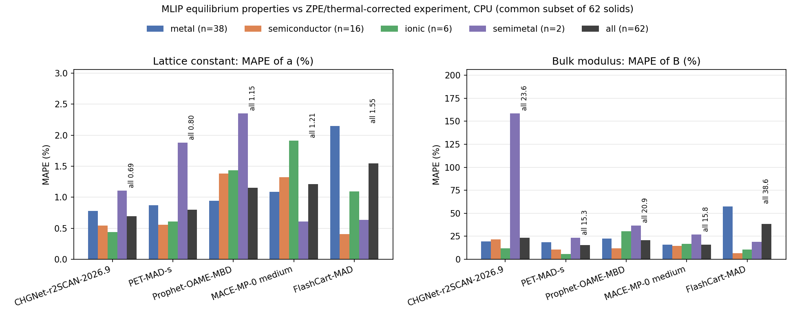
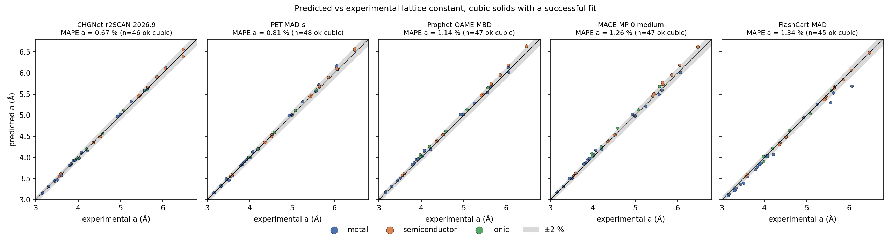
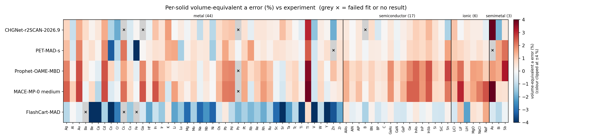
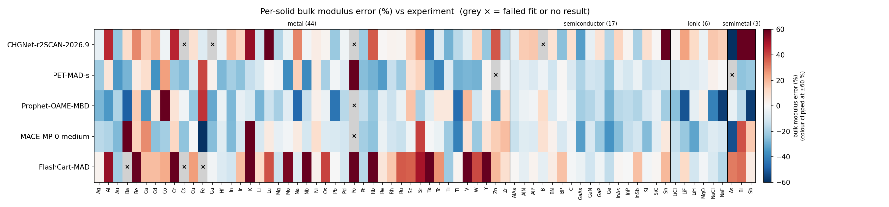
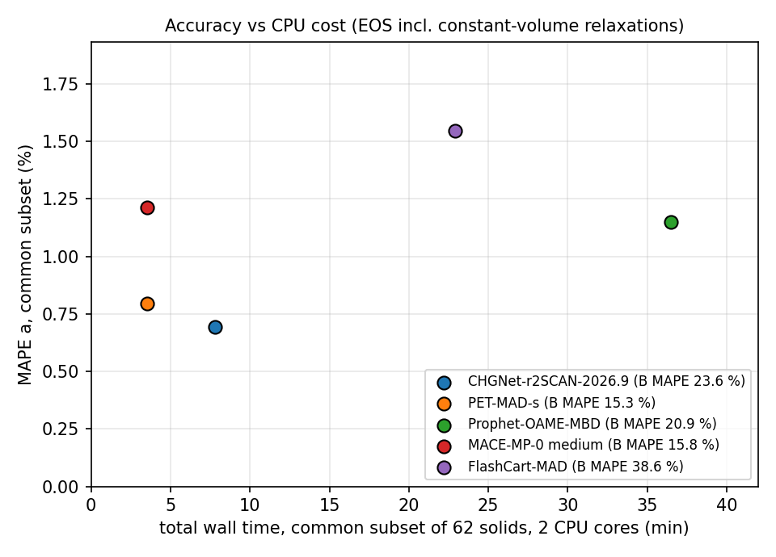

# CPU equation-of-state benchmark of five machine-learned interatomic potentials

Generated 2026-11-02 08:43 KST by `make_reports.py` from `results/summary.json`, `results/tables.md` and `logs/*.res` (tables by `aggregate.py`).

## Summary
- 70 solids, five models. Solids with a successful fit: CHGNet-r2SCAN-2026.9 66/70, PET-MAD-s 68/70, Prophet-OAME-MBD 69/70, MACE-MP-0 medium 69/70, FlashCart-MAD 67/70.
- **Common set** (solids every model fitted successfully): **n = 62**. All headline numbers below use this set, so the models are compared on the same solids.
- Lowest lattice-constant error on the common set: **CHGNet-r2SCAN-2026.9** (MAPE a 0.69 %). Lowest bulk-modulus error: **PET-MAD-s** (MAPE B 15.3 %).

| Model | ok / 70 | MAPE a (%) | MAPE B (%) | ME a (%) | ME B (%) | wall, common set (s) |
|---|---|---|---|---|---|---|
| CHGNet-r2SCAN-2026.9 | 66 | 0.69 | 23.6 | +0.24 | +11.7 | 469 |
| PET-MAD-s | 68 | 0.80 | 15.3 | +0.49 | -12.3 | 211 |
| Prophet-OAME-MBD | 69 | 1.15 | 20.9 | +1.05 | -10.2 | 2189 |
| MACE-MP-0 medium | 69 | 1.21 | 15.8 | +1.04 | -6.6 | 211 |
| FlashCart-MAD | 67 | 1.55 | 38.6 | -1.33 | +32.1 | 1375 |

MAPE = mean absolute percentage error against experiment; ME = mean signed error (positive = model overestimates). For non-cubic solids "a" is the volume-equivalent lattice constant, (V/atom)^(1/3); its error is one third of the volume error to first order. The table is sorted by MAPE a.

## Method
- **Structures.** The 44 cubic solids from TSB16 are built with `ase.build.bulk` (primitive cell). The 26 extra elements from LEJ14 use the paper's ancillary CIFs, scaled isotropically to the experimental volume. Class counts: semiconductor 17, ionic 6, metal 44, semimetal 3.
- **Strain range.** 11 volumes spaced evenly over [0.94, 1.06] × V_centre, i.e. ±6 % in volume (about ±2 % linear strain, as in the Delta test).
- **Relaxation.** If a cell has free shape or internal degrees of freedom, each volume gets a constant-volume relaxation of cell shape and atomic positions, with symmetry kept (ASE FixSymmetry symprec 1e-3, FrechetCellFilter(constant_volume=True), BFGS, fmax 0.005 eV/Å, max 300 steps). Cubic 1- and 2-atom cells have no free coordinates and get single-point energies.
- **EOS fit.** Third-order Birch–Murnaghan (`ase.eos`), giving V0, B0 and B0'. If |V0/V_centre − 1| > 3 %, the grid is recentred and refitted, at most 3 passes. A fit **fails** if V0 is outside the sampled range, B0 ≤ 0, or any energy is not finite. A relaxation that reaches 300 steps without converging is kept with a warning in the result JSON, not counted as a failure (this happened only for CHGNet-r2SCAN: 10 volume points on Hf, Lu, Tc, Y and Zr, and 6 on B, which failed anyway). We report completion counts over all 70 solids. Accuracy averages on the common set use only the solids completed by every model; failures receive no numerical penalty in those averages. Every failure is listed below.
- **Settings.** No k-points. No spin input: we did not specify or optimise magnetic order. float64 where the model supports it. Settings are stored in every result JSON under `settings`.
- **Metrics.** a error = (a_model − a_ref)/a_ref. B error = (B0,model − B_ref)/B_ref. The parity plot uses cubic solids only.

## Reference data (`refs/`)
- **TSB16:** F. Tran, J. Stelzl, P. Blaha, J. Chem. Phys. 144, 204120 (2016). 44 cubic solids, column `Expt.` of the CMR `uafd` CSVs (`refs/lattice_constants.csv`, `refs/bulk_moduli.csv`), already corrected for thermal expansion and zero-point effects.
- **LEJ14:** K. Lejaeghere et al., Crit. Rev. Solid State Mater. Sci. 39, 1 (2014), arXiv:1204.2733v5. 26 extra elements; V0 and B0 with thermal and zero-point corrections (V = raw − ΔV1 − ΔV2) and the ancillary CIFs.
- `refs/solids.json` is built by `build_refs.py`, which also stores checksums. `refs/README.md` lists the exclusions (molecular and van der Waals crystals, S, Mn, Hg, and data sets that could not be downloaded). The two sources are **not independent**: TSB16 reuses LEJ14's corrections for elements.

## Results

### Overall (all columns from `results/tables.md`)
| Model | solids ok / 70 (failed) | MAPE a (%) common | MAPE B (%) common | MAPE a (%) all ok | MAPE B (%) all ok | mean signed a err (%) | mean signed B err (%) | MAPE a (%) excl. Fe/Co/Ni/Cr | worst a | worst B |
|---|---|---|---|---|---|---|---|---|---|---|
| CHGNet-r2SCAN-2026.9 | 66/70 (4) | 0.69 | 23.6 | 0.76 | 24.5 | +0.27 | +10.1 | 0.73 | As +4.1 | Sb +201 |
| PET-MAD-s | 68/70 (2) | 0.80 | 15.3 | 0.83 | 16.4 | +0.41 | -10.5 | 0.72 | Fe -4.5 | Po +64 |
| Prophet-OAME-MBD | 69/70 (1) | 1.15 | 20.9 | 1.14 | 21.3 | +1.04 | -10.1 | 1.19 | Tl +3.6 | Co +231 |
| MACE-MP-0 medium | 69/70 (1) | 1.21 | 15.8 | 1.24 | 18.1 | +1.08 | -6.8 | 1.30 | As +4.9 | Ba +80 |
| FlashCart-MAD | 67/70 (3) | 1.55 | 38.6 | 1.55 | 37.9 | -1.34 | +31.6 | 1.46 | Sr -6.0 | K +499 |

"all ok" columns use every solid that model fitted, so they cover different sets of solids and should not be used to rank models.

### Per class (common set)
| Model | metal (n=38) a / B | semiconductor (n=16) a / B | ionic (n=6) a / B | semimetal (n=2) a / B | oxide: MgO (n=1) a / B |
|---|---|---|---|---|---|
| CHGNet-r2SCAN-2026.9 | 0.78 / 19.2 | 0.54 / 21.5 | 0.44 / 11.9 | 1.11 / 158.6 | +0.31 / -3.5 |
| PET-MAD-s | 0.87 / 18.5 | 0.56 / 10.6 | 0.61 / 5.6 | 1.88 / 23.2 | +0.33 / -4.7 |
| Prophet-OAME-MBD | 0.94 / 22.3 | 1.38 / 12.0 | 1.44 / 30.6 | 2.35 / 36.6 | +1.63 / +3.5 |
| MACE-MP-0 medium | 1.09 / 15.7 | 1.33 / 14.6 | 1.91 / 16.6 | 0.61 / 27.0 | +1.56 / -13.3 |
| FlashCart-MAD | 2.15 / 57.5 | 0.41 / 6.7 | 1.09 / 10.4 | 0.64 / 19.1 | +0.62 / -1.9 |

The oxide class has only MgO (n = 1), so it is reported per solid: CHGNet-r2SCAN-2026.9 a +0.31 % / B -3.5 %; PET-MAD-s a +0.33 % / B -4.7 %; Prophet-OAME-MBD a +1.63 % / B +3.5 %; MACE-MP-0 medium a +1.56 % / B -13.3 %; FlashCart-MAD a +0.62 % / B -1.9 %. The semimetal class in the common set has only n = 2 (Bi, Sb), so its averages are dominated by single solids.

### Charts

## CPU timing
All jobs ran on the same shared 8-core box, pinned to cores 6,7 (`taskset -c 6,7`) at `nice -n 10`, with 2 threads (OMP/MKL/torch) and float64, one model at a time. `job.sh` records the job wall time and peak RSS, and an RSS watchdog kills a job above its limit. "Fresh single point" is the median time of 3 energy + forces + stress evaluations on new structures.

| Model | model load (s) | RSS after load (MB) | median wall / cubic solid (s) | median wall / non-cubic solid (s) | slowest solid (s) | total wall, common subset (s) | total wall, all solids with a result (s) | median fresh single point E+F+σ (ms) | median / max process RSS per structure (MB) | job peak RSS (MB) |
|---|---|---|---|---|---|---|---|---|---|---|
| MACE-MP-0 medium | 3.3 | 491 | 0.5 | 6.7 | Ga 101 | 211 | 464 | 29 | 612 / 892 | 876 |
| PET-MAD-s | 6.6 | 755 | 0.3 | 9.5 | As 56 | 211 | 342 | 24 | 928 / 973 | 973 |
| CHGNet-r2SCAN-2026.9 | 3.9 | 483 | 0.1 | 15.3 | B 1125 | 469 | 1873 | 9 | 600 / 966 | 923 |
| FlashCart-MAD | 2.9 | 423 | 0.5 | 77.4 | B 482 | 1375 | 2276 | 156 | 487 / 715 | 713 |
| Prophet-OAME-MBD | 6.8 | 923 | 9.6 | 79.0 | B 1207 | 2189 | 4874 | 554 | 1437 / 3497 | 3381 (max of 26 jobs) |

Job records (`logs/*.res`):

| job | rc | wall (s) | peak RSS (MB) | finished |
|---|---|---|---|---|
| chgnet_r2scan | 0 | 1927 | 923 | 2026-11-01 23:05:22 KST |
| flashcart_mad | 0 | 2524 | 713 | 2026-11-02 00:11:13 KST |
| mace_mp | 0 | 479 | 876 | 2026-11-01 23:13:21 KST |
| pet_mad_s | 0 | 362 | 973 | 2026-11-01 23:19:23 KST |
| prophet | 137 | 586 | 3048 | 2026-11-01 23:29:09 KST |
| prophet__As | 0 | 548 | 1455 | 2026-11-02 00:37:40 KST |
| prophet__B | 0 | 1247 | 3381 | 2026-11-02 01:44:35 KST |
| prophet__Bi | 0 | 240 | 1191 | 2026-11-02 00:53:56 KST |
| prophet__Cd | 0 | 101 | 1109 | 2026-11-02 01:15:15 KST |
| prophet__Co | 0 | 138 | 1243 | 2026-11-02 01:05:16 KST |
| prophet__Cr | 0 | 367 | 1227 | 2026-11-02 01:02:31 KST |
| prophet__Fe | 0 | 27 | 1229 | 2026-11-02 01:02:58 KST |
| prophet__Ga | 0 | 849 | 1632 | 2026-11-02 00:28:27 KST |
| prophet__Hf | 0 | 48 | 1089 | 2026-11-02 01:18:45 KST |
| prophet__In | 0 | 89 | 1340 | 2026-11-02 01:16:44 KST |
| prophet__Lu | 0 | 73 | 1077 | 2026-11-02 01:17:57 KST |
| prophet__Mg | 0 | 54 | 1095 | 2026-11-02 00:54:50 KST |
| prophet__Os | 0 | 98 | 1191 | 2026-11-02 01:22:09 KST |
| prophet__Pb | 0 | 25 | 1242 | 2026-11-02 00:14:18 KST |
| prophet__Po | 0 | 9 | 1309 | 2026-11-02 01:23:48 KST |
| prophet__Re | 0 | 106 | 1201 | 2026-11-02 01:20:31 KST |
| prophet__Ru | 0 | 162 | 1234 | 2026-11-02 01:13:34 KST |
| prophet__Sb | 0 | 735 | 1278 | 2026-11-02 00:49:56 KST |
| prophet__Sc | 0 | 38 | 1278 | 2026-11-02 00:55:28 KST |
| prophet__Tc | 0 | 59 | 1186 | 2026-11-02 01:10:52 KST |
| prophet__Ti | 0 | 56 | 1156 | 2026-11-02 00:56:24 KST |
| prophet__Tl | 0 | 90 | 1083 | 2026-11-02 01:23:39 KST |
| prophet__Y | 0 | 59 | 1395 | 2026-11-02 01:08:47 KST |
| prophet__Zn | 0 | 152 | 1181 | 2026-11-02 01:07:48 KST |
| prophet__Zr | 0 | 66 | 1159 | 2026-11-02 01:09:53 KST |

Prophet was not run as a single job. The original sequential job (`logs/prophet.res`) was stopped by the RSS watchdog (limit 3000 MB) while on B, so the remaining solids were run one per process (`logs/prophet__<solid>.res`) with the same cores, nice level and thread count. Sum of Prophet job wall times: 6022 s; largest job peak RSS: 3381 MB; jobs with non-zero exit code: prophet. The B retry used a 3500 MB watchdog limit; all other Prophet jobs used 3000 MB. B (12-atom cell) is Prophet's memory peak: the in-process monitor recorded 3497 MB, i.e. right at the ~3.5 GB budget. An earlier helper script (`resume_prophet.sh`) that would have batched many solids in one process was stopped (only its bash driver; the running Ga job was left alone) and replaced by `run_prophet_remaining.sh`, which runs one solid per job and skips solids that already have a JSON.

Timing caveats: other processes were running on the box, so these are observed workflow runtimes, not a controlled speed comparison. Per-solid wall time includes the constant-volume relaxations, so non-cubic solids are much slower than cubic ones, and the totals depend on how many relaxation steps each model needs. Model-loading policies also differ (Prophet reloads the model for each solid run after its watchdog restart). Shared-host contention and these loading differences prevent a controlled speed comparison.

## Failures
**CHGNet-r2SCAN-2026.9** — 66/70 ok, 4 not ok
- B: V0 outside sampled range; B0 non-positive/non-finite
- Cs: V0 outside sampled range
- Ga: LinAlgError: SVD did not converge
- Po: KeyError: 'Po'
- warnings: B (some constant-volume relaxations hit max_steps); Hf (some constant-volume relaxations hit max_steps); Lu (some constant-volume relaxations hit max_steps); Tc (some constant-volume relaxations hit max_steps); Y (some constant-volume relaxations hit max_steps); Zr (some constant-volume relaxations hit max_steps)

**PET-MAD-s** — 68/70 ok, 2 not ok
- As: V0 outside sampled range
- Zn: B0 non-positive/non-finite

**Prophet-OAME-MBD** — 69/70 ok, 1 not ok
- Po: KeyError: np.int64(84)

**MACE-MP-0 medium** — 69/70 ok, 1 not ok
- Po: ValueError: np.int64(84) is not in list

**FlashCart-MAD** — 67/70 ok, 3 not ok
- Ba: V0 outside sampled range
- Cs: RuntimeError: cannot reshape tensor of 0 elements into shape [0, -1] because the unspecified dimension size -1 can be any value and is ambiguous
- Fe: V0 outside sampled range; B0 non-positive/non-finite

Failed fits were not retried. Prophet's B was not a failed fit but a watchdog kill in the original run; it got exactly one retry with a 3500 MB limit: exit code 0, wall 1247 s, peak RSS 3381 MB, fit ok. The Po errors (KeyError 'Po' for CHGNet; KeyError / ValueError on atomic number 84 for Prophet and MACE) mean those models have no parameters for polonium; they are element-coverage failures, not EOS-fit failures.

## Model licences
| Model | Checkpoint used | Code licence | Weights licence |
|---|---|---|---|
| CHGNet-r2SCAN-2026.9 | CHGNet-PES-MatPES-r2SCAN-1M-2026.9 via matgl; trained on MatPES r2SCAN 2025.2 | matgl (BSD-3-Clause) | No licence stated on the Hugging Face model card (checked materialyze/ and BowenD-UCB/ repos); treat as unspecified |
| PET-MAD-s | pet-mad-s, version 'latest', via UPETCalculator | upet (BSD-3-Clause) | BSD-3-Clause (Hugging Face lab-cosmo/upet tag) |
| Prophet-OAME-MBD | prophet-oame-mbd.pt via KairosCalculator (use_kernel=False) | MIT (Kairos Materials; backbone derived from Nequix, MIT) | CC-BY-4.0 (LICENSE-WEIGHTS; Hugging Face kairosmaterial/prophet tag) |
| MACE-MP-0 medium | MACE-MP-0 medium, 2023-12-03 checkpoint, float64 | mace-torch (MIT) | MIT (mace-foundations README) |
| FlashCart-MAD | FlashCart-2.3M, MAD training set, seed 0, cutoff 5 Å | Apache-2.0 | Apache-2.0 (Zenodo 10.5281/zenodo.23159584; arXiv 2610.06409) |

Check the upstream repositories before redistributing weights. The CHGNet-r2SCAN model card states no licence.

## Per-solid results
| Solid | class | ref source | a_ref or V_ref | B_ref (GPa) | CHGNet-r2SCAN-2026.9 Δa% / ΔB% | PET-MAD-s Δa% / ΔB% | Prophet-OAME-MBD Δa% / ΔB% | MACE-MP-0 medium Δa% / ΔB% | FlashCart-MAD Δa% / ΔB% |
|---|---|---|---|---|---|---|---|---|---|
| Ag | metal | TSB16 | a=4.070 Å | 105.7 | +0.87 / -5 | +1.20 / -21 | +1.98 / -27 | +2.40 / -16 | -1.09 / +2 |
| Al | metal | TSB16 | a=4.022 Å | 77.1 | -0.93 / +45 | -0.68 / +7 | +0.16 / -34 | +0.95 / -18 | +0.01 / +52 |
| Au | metal | TSB16 | a=4.067 Å | 182.0 | +1.45 / -24 | +1.95 / -34 | +2.53 / -18 | +2.69 / -26 | -0.47 / -21 |
| Ba | metal | TSB16 | a=4.994 Å | 10.6 | +0.72 / +10 | +0.36 / -28 | +0.46 / -49 | -0.18 / +80 | -7.10 / +555 FAIL |
| Be | metal | LEJ14 | V=7.82 ų/at | 108.1 | +0.14 / +29 | +0.63 / +5 | -0.00 / +15 | +0.81 / +14 | -4.91 / +61 |
| Ca | metal | TSB16 | a=5.559 Å | 15.9 | +0.46 / +15 | +0.14 / +10 | -0.43 / -35 | -1.11 / +28 | -4.71 / +18 |
| Cd | metal | LEJ14 | V=21.01 ų/at | 50.7 | +1.49 / +20 | +1.91 / -36 | +2.51 / +7 | +2.61 / -25 | -1.28 / +19 |
| Co | metal | LEJ14 | V=10.96 ų/at | 198.4 | -1.19 / -2 | -3.32 / +25 | +0.85 / +231 | -0.55 / -20 | -4.55 / +22 |
| Cr | metal | LEJ14 | a=2.870 Å | 204.6 | -1.97 / +46 | -1.07 / -22 | -0.51 / +8 | -0.13 / +13 | -2.77 / +184 |
| Cs | metal | TSB16 | a=6.043 Å | 2.3 | -0.02 / +132 FAIL | +2.14 / -26 | +1.54 / -2 | +2.21 / -24 | +nan / +nan FAIL |
| Cu | metal | TSB16 | a=3.599 Å | 144.3 | -0.62 / +9 | -0.55 / -9 | +0.63 / -23 | +0.74 / -0 | -1.52 / +25 |
| Fe | metal | LEJ14 | a=2.855 Å | 175.1 | +0.09 / -8 | -4.55 / +40 | -0.37 / +43 | -0.07 / -59 | +1.89 / -284 FAIL |
| Ga | metal | LEJ14 | V=19.15 ų/at | 60.2 | +nan / +nan FAIL | +0.05 / +3 | +1.93 / -31 | +2.52 / -25 | -0.67 / -2 |
| Hf | metal | LEJ14 | V=22.30 ų/at | 110.7 | -0.27 / -3 | +0.32 / -27 | +0.30 / -4 | +0.36 / -7 | -2.07 / -8 |
| In | metal | LEJ14 | V=25.70 ų/at | 44.7 | +1.13 / +19 | +0.62 / -20 | +1.88 / -27 | +2.52 / -26 | -0.89 / -11 |
| Ir | metal | TSB16 | a=3.831 Å | 362.2 | +0.55 / +13 | +0.55 / -25 | +1.12 / -5 | +1.41 / -10 | -1.48 / +19 |
| K | metal | TSB16 | a=5.246 Å | 3.8 | +1.67 / +52 | +1.46 / -14 | +0.79 / -9 | -0.72 / +74 | +0.42 / +499 |
| Li | metal | TSB16 | a=3.443 Å | 13.1 | -0.00 / -11 | +1.54 / -9 | +0.33 / -28 | +1.64 / -10 | -2.12 / +11 |
| Lu | metal | LEJ14 | V=29.27 ų/at | 42.0 | +0.37 / +94 | -1.33 / +0 | +0.51 / -13 | +0.72 / +5 | -1.51 / +38 |
| Mg | metal | LEJ14 | V=22.65 ų/at | 38.6 | -0.15 / -18 | +0.17 / -2 | +0.57 / -20 | +0.18 / -5 | -3.08 / -13 |
| Mo | metal | TSB16 | a=3.142 Å | 276.2 | +0.46 / -4 | +0.64 / -37 | +0.76 / -7 | +0.90 / -2 | -1.31 / +57 |
| Na | metal | TSB16 | a=4.205 Å | 7.9 | -1.00 / +29 | +0.40 / +14 | -0.28 / -47 | -0.22 / +5 | -3.15 / -7 |
| Nb | metal | TSB16 | a=3.300 Å | 173.2 | +0.45 / -2 | +0.46 / -38 | +0.54 / -14 | +0.41 / -11 | -2.34 / +98 |
| Ni | metal | TSB16 | a=3.510 Å | 192.5 | -1.10 / +4 | -1.39 / +6 | +0.05 / +3 | +0.01 / +10 | -3.20 / +2 |
| Os | metal | LEJ14 | V=13.85 ų/at | 424.6 | +0.75 / +2 | +0.48 / -20 | +1.19 / -4 | +1.30 / -8 | -0.64 / +40 |
| Pb | metal | LEJ14 | a=4.925 Å | 46.3 | +1.03 / -22 | +1.55 / -2 | +1.90 / -44 | +2.08 / -9 | +0.40 / -0 |
| Pd | metal | TSB16 | a=3.876 Å | 187.2 | +1.12 / -3 | +0.75 / -8 | +1.97 / -16 | +2.11 / -11 | -1.03 / -11 |
| Po | metal | LEJ14 | a=3.330 Å | 27.4 | +nan / +nan FAIL | -0.10 / +64 | +nan / +nan FAIL | +nan / +nan FAIL | -1.79 / +88 |
| Pt | metal | TSB16 | a=3.917 Å | 285.5 | +0.59 / -22 | +0.85 / -26 | +1.46 / -14 | +1.51 / -21 | -1.31 / -17 |
| Rb | metal | TSB16 | a=5.629 Å | 3.6 | -0.35 / +37 | +1.66 / -28 | +0.71 / -23 | -0.62 / -24 | -1.79 / +489 |
| Re | metal | LEJ14 | V=14.62 ų/at | 380.8 | +0.49 / +1 | +0.22 / -33 | +1.01 / -6 | +0.94 / -4 | -1.40 / +7 |
| Rh | metal | TSB16 | a=3.786 Å | 277.1 | +0.49 / +2 | +0.45 / -14 | +1.51 / -13 | +1.71 / -12 | -1.98 / +16 |
| Ru | metal | LEJ14 | V=13.45 ų/at | 335.5 | +0.32 / +2 | +0.16 / -22 | +1.13 / -4 | +1.25 / -13 | -1.13 / +37 |
| Sc | metal | LEJ14 | V=24.77 ų/at | 44.5 | +0.25 / +14 | +0.61 / +9 | -0.19 / +17 | -0.18 / -2 | -3.09 / +36 |
| Sr | metal | TSB16 | a=6.059 Å | 12.0 | +1.20 / +24 | +0.56 / +14 | -0.53 / -20 | -0.71 / +41 | -5.99 / +50 |
| Ta | metal | TSB16 | a=3.298 Å | 202.7 | +0.67 / -43 | +0.35 / -33 | +0.62 / -7 | +0.48 / -1 | -2.22 / +60 |
| Tc | metal | LEJ14 | V=14.22 ų/at | 303.1 | +0.05 / -9 | +0.25 / -39 | +0.85 / +6 | +0.89 / -4 | -1.08 / +27 |
| Ti | metal | LEJ14 | V=17.50 ų/at | 107.4 | -0.46 / -28 | -0.10 / -8 | -0.29 / +6 | +0.24 / -22 | -3.84 / -22 |
| Tl | metal | LEJ14 | V=27.99 ų/at | 37.4 | +3.05 / -16 | +2.41 / -29 | +3.64 / -46 | +3.86 / -41 | +0.69 / +2 |
| V | metal | TSB16 | a=3.023 Å | 165.8 | -1.62 / -7 | -0.79 / -27 | -0.75 / +20 | -0.79 / +8 | -5.01 / +88 |
| W | metal | TSB16 | a=3.162 Å | 327.5 | +0.32 / +14 | +0.27 / -28 | +0.77 / -11 | +0.84 / -22 | -0.99 / +40 |
| Y | metal | LEJ14 | V=32.95 ų/at | 37.3 | +0.11 / -23 | +0.64 / +1 | -0.07 / +2 | -0.35 / +8 | -4.08 / +66 |
| Zn | metal | LEJ14 | V=14.86 ų/at | 64.7 | -1.95 / +37 | -0.88 / -332 FAIL | +1.17 / -32 | +0.26 / +15 | -3.44 / +20 |
| Zr | metal | LEJ14 | V=23.18 ų/at | 84.3 | +0.45 / -17 | +0.61 / -2 | +0.56 / +10 | +0.45 / +18 | -2.05 / +10 |
| AlAs | semiconductor | TSB16 | a=5.649 Å | 75.0 | +0.42 / -5 | +0.58 / -9 | +1.38 / -9 | +1.42 / -13 | +0.47 / +1 |
| AlN | semiconductor | TSB16 | a=4.368 Å | 206.0 | +0.00 / +15 | +0.06 / -6 | +0.75 / -3 | +0.62 / -7 | -0.35 / -5 |
| AlP | semiconductor | TSB16 | a=5.451 Å | 87.4 | +0.45 / +16 | +0.45 / -9 | +0.99 / -2 | +1.19 / -8 | -0.13 / +2 |
| B | semiconductor | LEJ14 | V=7.16 ų/at | 185.9 | +nan / -186 FAIL | -0.12 / -3 | +0.49 / +11 | +0.12 / +9 | -1.26 / -5 |
| BN | semiconductor | TSB16 | a=3.592 Å | 410.2 | +0.70 / +9 | +0.36 / -12 | +0.93 / -8 | +0.95 / +2 | +0.16 / +5 |
| BP | semiconductor | TSB16 | a=4.525 Å | 168.0 | -0.64 / -25 | +0.33 / +1 | +0.48 / +0 | +0.36 / -10 | -0.76 / +17 |
| C | semiconductor | TSB16 | a=3.553 Å | 454.7 | +0.03 / +10 | +0.09 / -9 | +0.62 / -4 | +0.49 / -2 | -0.34 / -1 |
| GaAs | semiconductor | TSB16 | a=5.640 Å | 76.7 | +0.45 / -33 | +0.58 / -18 | +1.87 / -20 | +1.79 / -33 | +0.27 / -4 |
| GaN | semiconductor | TSB16 | a=4.509 Å | 213.7 | -0.17 / -5 | -0.25 / -11 | +0.78 / -17 | +0.55 / -10 | -0.67 / -12 |
| GaP | semiconductor | TSB16 | a=5.439 Å | 89.6 | +0.26 / +9 | +0.17 / -13 | +1.21 / -13 | +1.35 / -22 | -0.72 / -3 |
| Ge | semiconductor | TSB16 | a=5.641 Å | 79.4 | +0.48 / -18 | +0.83 / -25 | +1.93 / -28 | +2.35 / -36 | -0.14 / -15 |
| InAs | semiconductor | TSB16 | a=6.047 Å | 58.6 | +0.94 / +13 | +0.92 / -6 | +2.34 / -17 | +2.36 / -25 | +0.41 / +1 |
| InP | semiconductor | TSB16 | a=5.858 Å | 72.0 | +0.80 / +1 | +0.77 / -11 | +1.75 / -15 | +1.73 / -14 | -0.28 / -0 |
| InSb | semiconductor | TSB16 | a=6.473 Å | 46.1 | +1.30 / -19 | +1.04 / -4 | +2.52 / -18 | +2.47 / -11 | +0.10 / +18 |
| Si | semiconductor | TSB16 | a=5.412 Å | 101.3 | +0.61 / +9 | +0.60 / -14 | +1.03 / -10 | +0.81 / -26 | -0.72 / -2 |
| SiC | semiconductor | TSB16 | a=4.346 Å | 229.1 | +0.13 / +1 | +0.28 / -11 | +0.77 / -5 | +0.69 / -6 | -0.79 / +1 |
| Sn | semiconductor | TSB16 | a=6.477 Å | 42.8 | -1.25 / +155 | +1.61 / -11 | +2.71 / -21 | +2.09 / +6 | +0.18 / +19 |
| LiCl | ionic | TSB16 | a=5.070 Å | 38.7 | +1.14 / +1 | +0.99 / -9 | +1.48 / -25 | +1.18 / -14 | -0.66 / -12 |
| LiF | ionic | TSB16 | a=3.972 Å | 76.3 | -0.04 / +24 | +0.84 / -8 | +2.19 / -52 | +3.05 / -23 | +1.17 / +12 |
| LiH | ionic | TSB16 | a=3.979 Å | 40.1 | +0.44 / +12 | +0.56 / -8 | +0.77 / -6 | +1.07 / -32 | -2.15 / -11 |
| MgO | ionic (oxide) | TSB16 | a=4.189 Å | 169.8 | +0.31 / -4 | +0.33 / -5 | +1.63 / +4 | +1.56 / -13 | +0.62 / -2 |
| NaCl | ionic | TSB16 | a=5.569 Å | 27.6 | +0.30 / +16 | +0.60 / +3 | +1.57 / -41 | +2.05 / -8 | +0.44 / -9 |
| NaF | ionic | TSB16 | a=4.582 Å | 53.1 | -0.40 / +14 | +0.34 / +0 | +0.97 / -56 | +2.55 / -10 | +1.50 / -17 |
| As | semimetal | LEJ14 | V=21.23 ų/at | 40.8 | +4.06 / -100 | +7.18 / -63 FAIL | +1.69 / -4 | +4.93 / -53 | -0.63 / +31 |
| Bi | semimetal | LEJ14 | V=35.13 ų/at | 32.1 | -1.84 / +116 | +1.55 / -24 | +1.48 / -16 | +0.63 / +38 | -1.10 / +33 |
| Sb | semimetal | LEJ14 | V=29.68 ų/at | 39.5 | +0.38 / +201 | +2.20 / -22 | +3.22 / -57 | +0.59 / +16 | -0.17 / +5 |

## Limitations
- **Magnetism:** Fe, Co, Ni (ferromagnetic) and Cr (antiferromagnetic) are run without any spin or magnetic-order input. We did not specify or optimise magnetic order, so this benchmark does not test recovery of the correct magnetic states of Fe, Co, Ni or Cr. The overall table has a column that excludes them.
- **Oxides:** MgO is the only oxide with a corrected reference, so there is no meaningful oxide average.
- **Bulk-modulus uncertainty:** experimental B carries several % uncertainty (different techniques), and B from a ±6 % volume fit is sensitive to noise in the energy surface. Soft alkali and alkaline-earth metals (K, Rb, Cs, Ba), whose reference B is very small, produce very large percentage errors that dominate B MAPE.
- **References:** the two sources share corrections and are not independent. The zero-point corrections are model-based.
- **Coverage:** the common set (n = 62) is biased towards cubic solids; see `results/summary.json` → `common_subset` for the exact list.
- **Timing:** measured on a shared machine with 2 threads. Prophet was run as per-solid jobs (see CPU timing), so its job totals include one model load per solid.
- **No temperature or pressure:** the static-lattice E(V) is compared with experiment corrected to the static lattice. No phonon or finite-temperature effects are modelled.

## Files
`bench_mlip.py` (protocol), `job.sh` / `run_all.sh` / `run_prophet_remaining.sh` (job launchers), `aggregate.py` (tables and charts), `make_reports.py` (this report), `results/<model>/*.json` (raw per-solid results), `results/all_results.csv`, `results/summary.json`, `results/tables.md`, `charts/*.png`, `logs/`.
