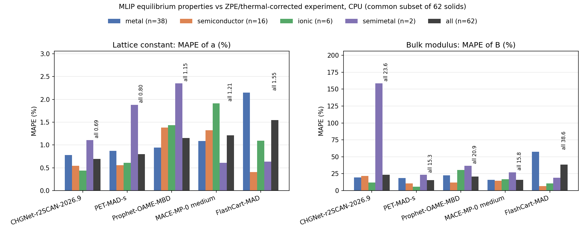
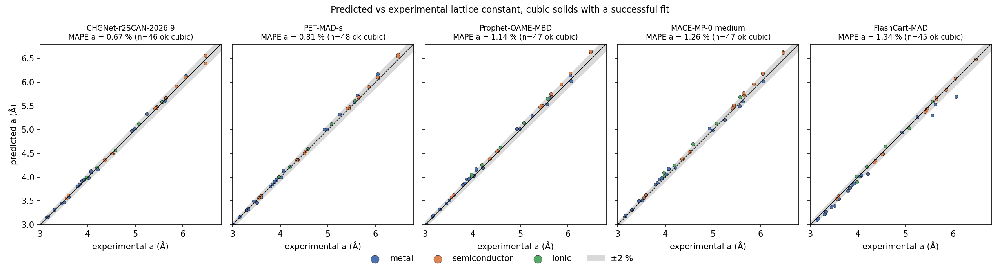
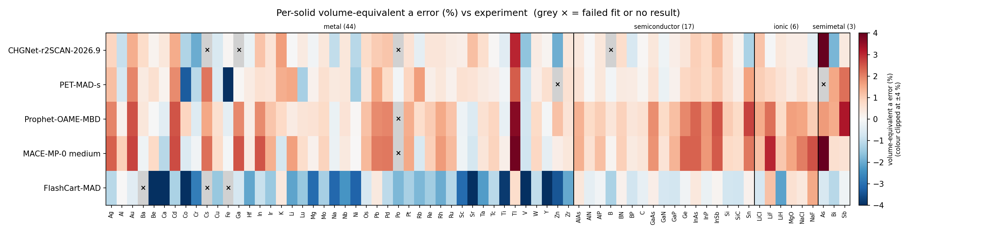
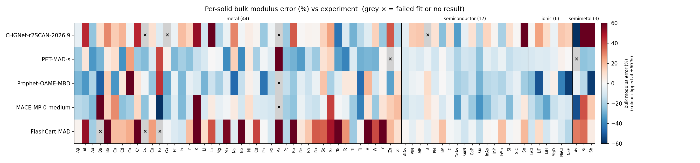
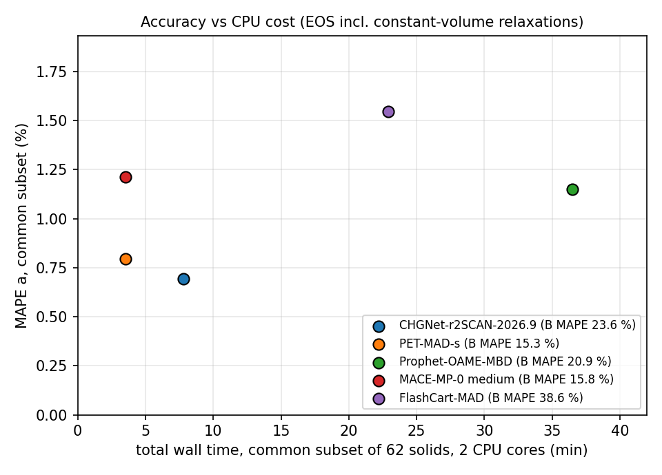

# 머신러닝 원자간 퍼텐셜 5종 CPU 상태방정식(EOS) 벤치마크

2026-11-02 08:43 KST에 `make_reports.py`가 `results/summary.json`, `results/tables.md`, `logs/*.res`를 읽어 생성했습니다. 표는 `aggregate.py`가 만든 것입니다.

## 요약
- 고체 70종, 모델 5종. 피팅에 성공한 고체 수: CHGNet-r2SCAN-2026.9 66/70, PET-MAD-s 68/70, Prophet-OAME-MBD 69/70, MACE-MP-0 medium 69/70, FlashCart-MAD 67/70.
- **공통 집합**(모든 모델이 피팅에 성공한 고체): **n = 62**. 아래 대표 수치는 모두 이 집합 기준이며, 모델을 같은 고체끼리 비교합니다.
- 공통 집합에서 격자상수 오차가 가장 작은 모델은 **CHGNet-r2SCAN-2026.9**(MAPE a 0.69 %), 체적탄성률 오차가 가장 작은 모델은 **PET-MAD-s**(MAPE B 15.3 %)입니다.

| 모델 | 성공 / 70 | MAPE a (%) | MAPE B (%) | ME a (%) | ME B (%) | wall, 공통 집합 (s) |
|---|---|---|---|---|---|---|
| CHGNet-r2SCAN-2026.9 | 66 | 0.69 | 23.6 | +0.24 | +11.7 | 469 |
| PET-MAD-s | 68 | 0.80 | 15.3 | +0.49 | -12.3 | 211 |
| Prophet-OAME-MBD | 69 | 1.15 | 20.9 | +1.05 | -10.2 | 2189 |
| MACE-MP-0 medium | 69 | 1.21 | 15.8 | +1.04 | -6.6 | 211 |
| FlashCart-MAD | 67 | 1.55 | 38.6 | -1.33 | +32.1 | 1375 |

MAPE는 실험값 대비 평균 절대 백분율 오차, ME는 평균 부호 오차(양수 = 모델이 과대 예측)입니다. 비입방정 고체의 "a"는 부피 등가 격자상수 (V/atom)^(1/3)이며, 그 오차는 1차 근사로 부피 오차의 1/3입니다. 표는 MAPE a 순으로 정렬했습니다.

## 방법
- **구조.** TSB16의 입방정 고체 44종은 `ase.build.bulk`(primitive cell)로 만들었습니다. LEJ14의 추가 원소 26종은 논문 부록 CIF를 실험 부피에 맞게 등방 스케일링해 썼습니다. 분류별 개수: semiconductor 17, ionic 6, metal 44, semimetal 3.
- **변형 범위.** [0.94, 1.06] × V_centre 구간에 균등 간격 11개 부피, 즉 부피 ±6 %(선형 변형 약 ±2 %, Delta test와 동일)입니다.
- **완화.** 셀 모양이나 내부 좌표에 자유도가 있으면 각 부피에서 대칭을 유지하며 셀 모양과 원자 위치를 정적 부피로 완화했습니다(ASE FixSymmetry symprec 1e-3, FrechetCellFilter(constant_volume=True), BFGS, fmax 0.005 eV/Å, 최대 300 step). 원자 1~2개짜리 입방정 셀은 자유 좌표가 없어 single point 에너지만 계산합니다.
- **EOS 피팅.** 3차 Birch–Murnaghan(`ase.eos`)으로 V0, B0, B0'를 구합니다. |V0/V_centre − 1| > 3 %이면 격자를 다시 중심에 맞춰 재피팅하며 최대 3회까지 반복합니다. V0가 샘플 범위 밖이거나 B0 ≤ 0이거나 에너지에 비유한값이 있으면 **실패**입니다. 300 step 안에 수렴하지 않은 완화는 결과 JSON에 경고를 남기고 유지하며 실패로 세지 않습니다(CHGNet-r2SCAN에서만 발생: Hf, Lu, Tc, Y, Zr의 부피 점 10개와 어차피 실패한 B의 6개). 완료 개수는 70종 전체 기준으로 보고합니다. 공통 집합의 정확도 평균은 모든 모델이 완료한 고체만 쓰며, 실패는 그 평균에서 수치상 불이익을 받지 않습니다. 실패는 모두 아래에 적었습니다.
- **설정.** k-point 없음. 스핀 입력 없음: 자기 질서를 지정하거나 최적화하지 않았습니다. 모델이 지원하면 float64. 설정은 모든 결과 JSON의 `settings`에 저장됩니다.
- **지표.** a 오차 = (a_model − a_ref)/a_ref, B 오차 = (B0,model − B_ref)/B_ref. parity 그림은 입방정 고체만 씁니다.

## 기준 데이터 (`refs/`)
- **TSB16:** F. Tran, J. Stelzl, P. Blaha, J. Chem. Phys. 144, 204120 (2016). 입방정 고체 44종. CMR `uafd` CSV(`refs/lattice_constants.csv`, `refs/bulk_moduli.csv`)의 `Expt.` 열로, 열팽창과 영점 진동 효과가 이미 보정된 값입니다.
- **LEJ14:** K. Lejaeghere 외, Crit. Rev. Solid State Mater. Sci. 39, 1 (2014), arXiv:1204.2733v5. 추가 원소 26종. 열팽창·영점 보정을 적용한 V0와 B0(V = raw − ΔV1 − ΔV2)와 부록 CIF를 사용했습니다.
- `refs/solids.json`은 `build_refs.py`가 만들며 체크섬도 함께 기록합니다. 제외한 항목(분자성·반데르발스 결정, S, Mn, Hg, 내려받을 수 없던 데이터셋)은 `refs/README.md`에 정리되어 있습니다. 두 출처는 **서로 독립적이지 않습니다**. TSB16은 원소에 대해 LEJ14의 보정값을 그대로 씁니다.

## 결과

### 전체 (모든 열은 `results/tables.md`에서 가져옴)
| 모델 | 성공 / 70 (실패) | MAPE a (%) 공통 | MAPE B (%) 공통 | MAPE a (%) 전체 성공분 | MAPE B (%) 전체 성공분 | 평균 부호 오차 a (%) | 평균 부호 오차 B (%) | MAPE a (%) Fe/Co/Ni/Cr 제외 | 최대 a 오차 | 최대 B 오차 |
|---|---|---|---|---|---|---|---|---|---|---|
| CHGNet-r2SCAN-2026.9 | 66/70 (4) | 0.69 | 23.6 | 0.76 | 24.5 | +0.27 | +10.1 | 0.73 | As +4.1 | Sb +201 |
| PET-MAD-s | 68/70 (2) | 0.80 | 15.3 | 0.83 | 16.4 | +0.41 | -10.5 | 0.72 | Fe -4.5 | Po +64 |
| Prophet-OAME-MBD | 69/70 (1) | 1.15 | 20.9 | 1.14 | 21.3 | +1.04 | -10.1 | 1.19 | Tl +3.6 | Co +231 |
| MACE-MP-0 medium | 69/70 (1) | 1.21 | 15.8 | 1.24 | 18.1 | +1.08 | -6.8 | 1.30 | As +4.9 | Ba +80 |
| FlashCart-MAD | 67/70 (3) | 1.55 | 38.6 | 1.55 | 37.9 | -1.34 | +31.6 | 1.46 | Sr -6.0 | K +499 |

"전체 성공분" 열은 모델마다 피팅에 성공한 고체 전부를 쓰므로 모델별로 고체 집합이 다릅니다. 순위를 매기는 데 쓰면 안 됩니다.

### 분류별 (공통 집합)
| 모델 | metal (n=38) a / B | semiconductor (n=16) a / B | ionic (n=6) a / B | semimetal (n=2) a / B | oxide: MgO (n=1) a / B |
|---|---|---|---|---|---|
| CHGNet-r2SCAN-2026.9 | 0.78 / 19.2 | 0.54 / 21.5 | 0.44 / 11.9 | 1.11 / 158.6 | +0.31 / -3.5 |
| PET-MAD-s | 0.87 / 18.5 | 0.56 / 10.6 | 0.61 / 5.6 | 1.88 / 23.2 | +0.33 / -4.7 |
| Prophet-OAME-MBD | 0.94 / 22.3 | 1.38 / 12.0 | 1.44 / 30.6 | 2.35 / 36.6 | +1.63 / +3.5 |
| MACE-MP-0 medium | 1.09 / 15.7 | 1.33 / 14.6 | 1.91 / 16.6 | 0.61 / 27.0 | +1.56 / -13.3 |
| FlashCart-MAD | 2.15 / 57.5 | 0.41 / 6.7 | 1.09 / 10.4 | 0.64 / 19.1 | +0.62 / -1.9 |

산화물 분류에는 MgO 하나뿐(n = 1)이라 개별 값으로 보고합니다: CHGNet-r2SCAN-2026.9 a +0.31 % / B -3.5 %; PET-MAD-s a +0.33 % / B -4.7 %; Prophet-OAME-MBD a +1.63 % / B +3.5 %; MACE-MP-0 medium a +1.56 % / B -13.3 %; FlashCart-MAD a +0.62 % / B -1.9 %. 공통 집합의 semimetal은 n = 2(Bi, Sb)뿐이라 평균이 개별 고체에 좌우됩니다.

### 그림

## CPU 시간
모든 작업은 공유 8코어 머신에서 한 번에 한 모델씩 실행했습니다. 코어 6,7에 고정(`taskset -c 6,7`), `nice -n 10`, 스레드 2개(OMP/MKL/torch), float64입니다. `job.sh`가 작업 wall time과 peak RSS를 기록하고, RSS 감시가 한도를 넘는 작업을 종료합니다. "새 구조 single point"는 새 구조에 대해 에너지+힘+응력을 3번 계산한 시간의 중앙값입니다.

| 모델 | 모델 로드 (s) | 로드 후 RSS (MB) | 입방정 고체당 wall 중앙값 (s) | 비입방정 고체당 wall 중앙값 (s) | 가장 느린 고체 (s) | 총 wall, 공통 집합 (s) | 총 wall, 결과 있는 전체 (s) | 새 구조 single point E+F+σ 중앙값 (ms) | 구조당 프로세스 RSS 중앙값 / 최대 (MB) | 작업 peak RSS (MB) |
|---|---|---|---|---|---|---|---|---|---|---|
| MACE-MP-0 medium | 3.3 | 491 | 0.5 | 6.7 | Ga 101 | 211 | 464 | 29 | 612 / 892 | 876 |
| PET-MAD-s | 6.6 | 755 | 0.3 | 9.5 | As 56 | 211 | 342 | 24 | 928 / 973 | 973 |
| CHGNet-r2SCAN-2026.9 | 3.9 | 483 | 0.1 | 15.3 | B 1125 | 469 | 1873 | 9 | 600 / 966 | 923 |
| FlashCart-MAD | 2.9 | 423 | 0.5 | 77.4 | B 482 | 1375 | 2276 | 156 | 487 / 715 | 713 |
| Prophet-OAME-MBD | 6.8 | 923 | 9.6 | 79.0 | B 1207 | 2189 | 4874 | 554 | 1437 / 3497 | 3381 (작업 중 최대, 26개 작업) |

작업 기록 (`logs/*.res`):

| 작업 | 종료 코드 | wall (s) | peak RSS (MB) | 종료 시각 |
|---|---|---|---|---|
| chgnet_r2scan | 0 | 1927 | 923 | 2026-11-01 23:05:22 KST |
| flashcart_mad | 0 | 2524 | 713 | 2026-11-02 00:11:13 KST |
| mace_mp | 0 | 479 | 876 | 2026-11-01 23:13:21 KST |
| pet_mad_s | 0 | 362 | 973 | 2026-11-01 23:19:23 KST |
| prophet | 137 | 586 | 3048 | 2026-11-01 23:29:09 KST |
| prophet__As | 0 | 548 | 1455 | 2026-11-02 00:37:40 KST |
| prophet__B | 0 | 1247 | 3381 | 2026-11-02 01:44:35 KST |
| prophet__Bi | 0 | 240 | 1191 | 2026-11-02 00:53:56 KST |
| prophet__Cd | 0 | 101 | 1109 | 2026-11-02 01:15:15 KST |
| prophet__Co | 0 | 138 | 1243 | 2026-11-02 01:05:16 KST |
| prophet__Cr | 0 | 367 | 1227 | 2026-11-02 01:02:31 KST |
| prophet__Fe | 0 | 27 | 1229 | 2026-11-02 01:02:58 KST |
| prophet__Ga | 0 | 849 | 1632 | 2026-11-02 00:28:27 KST |
| prophet__Hf | 0 | 48 | 1089 | 2026-11-02 01:18:45 KST |
| prophet__In | 0 | 89 | 1340 | 2026-11-02 01:16:44 KST |
| prophet__Lu | 0 | 73 | 1077 | 2026-11-02 01:17:57 KST |
| prophet__Mg | 0 | 54 | 1095 | 2026-11-02 00:54:50 KST |
| prophet__Os | 0 | 98 | 1191 | 2026-11-02 01:22:09 KST |
| prophet__Pb | 0 | 25 | 1242 | 2026-11-02 00:14:18 KST |
| prophet__Po | 0 | 9 | 1309 | 2026-11-02 01:23:48 KST |
| prophet__Re | 0 | 106 | 1201 | 2026-11-02 01:20:31 KST |
| prophet__Ru | 0 | 162 | 1234 | 2026-11-02 01:13:34 KST |
| prophet__Sb | 0 | 735 | 1278 | 2026-11-02 00:49:56 KST |
| prophet__Sc | 0 | 38 | 1278 | 2026-11-02 00:55:28 KST |
| prophet__Tc | 0 | 59 | 1186 | 2026-11-02 01:10:52 KST |
| prophet__Ti | 0 | 56 | 1156 | 2026-11-02 00:56:24 KST |
| prophet__Tl | 0 | 90 | 1083 | 2026-11-02 01:23:39 KST |
| prophet__Y | 0 | 59 | 1395 | 2026-11-02 01:08:47 KST |
| prophet__Zn | 0 | 152 | 1181 | 2026-11-02 01:07:48 KST |
| prophet__Zr | 0 | 66 | 1159 | 2026-11-02 01:09:53 KST |

Prophet는 하나의 작업으로 끝까지 돌지 못했습니다. 처음의 순차 작업(`logs/prophet.res`)은 B 계산 중 RSS 감시(한도 3000 MB)에 의해 종료되었고, 나머지 고체는 같은 코어·nice·스레드 설정으로 고체 하나당 프로세스 하나씩(`logs/prophet__<solid>.res`) 실행했습니다. Prophet 작업 wall time 합계: 6022 s, 작업별 최대 peak RSS: 3381 MB, 비정상 종료 코드 작업: prophet. B 재시도만 감시 한도 3500 MB, 나머지 Prophet 작업은 3000 MB였습니다. B(원자 12개 셀)가 Prophet의 메모리 최대치로, 프로세스 내부 모니터 기준 3497 MB를 기록해 ~3.5 GB 예산에 거의 닿았습니다. 여러 고체를 한 프로세스로 묶어 돌리려던 이전 보조 스크립트(`resume_prophet.sh`)는 bash 드라이버만 중단하고(실행 중이던 Ga 작업은 그대로 둠) `run_prophet_remaining.sh`로 교체했습니다. 이 스크립트는 고체 하나당 작업 하나를 실행하고 JSON이 이미 있는 고체는 건너뜁니다.

시간 관련 주의: 다른 프로세스가 같은 머신에서 돌고 있었으므로 이 시간은 관측된 워크플로 실행 시간이며 통제된 속도 비교가 아닙니다. 고체당 wall time에는 정적 부피 완화가 포함되므로 비입방정 고체가 입방정보다 훨씬 느리고, 합계는 모델별로 필요한 완화 step 수에 따라 달라집니다. 모델 로딩 방식도 다릅니다(Prophet은 watchdog 재시작 이후 실행한 고체마다 모델을 다시 불러옵니다). 공유 머신의 부하와 이런 로딩 차이 때문에 통제된 속도 비교는 할 수 없습니다.

## 실패
**CHGNet-r2SCAN-2026.9** — 66/70 ok, 4 실패/결과 없음
- B: V0 outside sampled range; B0 non-positive/non-finite
- Cs: V0 outside sampled range
- Ga: LinAlgError: SVD did not converge
- Po: KeyError: 'Po'
- 경고: B (some constant-volume relaxations hit max_steps); Hf (some constant-volume relaxations hit max_steps); Lu (some constant-volume relaxations hit max_steps); Tc (some constant-volume relaxations hit max_steps); Y (some constant-volume relaxations hit max_steps); Zr (some constant-volume relaxations hit max_steps)

**PET-MAD-s** — 68/70 ok, 2 실패/결과 없음
- As: V0 outside sampled range
- Zn: B0 non-positive/non-finite

**Prophet-OAME-MBD** — 69/70 ok, 1 실패/결과 없음
- Po: KeyError: np.int64(84)

**MACE-MP-0 medium** — 69/70 ok, 1 실패/결과 없음
- Po: ValueError: np.int64(84) is not in list

**FlashCart-MAD** — 67/70 ok, 3 실패/결과 없음
- Ba: V0 outside sampled range
- Cs: RuntimeError: cannot reshape tensor of 0 elements into shape [0, -1] because the unspecified dimension size -1 can be any value and is ambiguous
- Fe: V0 outside sampled range; B0 non-positive/non-finite

피팅 실패는 재시도하지 않았습니다. Prophet의 B는 피팅 실패가 아니라 처음 실행에서 감시에 의해 종료된 경우로, 한도 3500 MB로 딱 한 번 재시도했습니다: 종료 코드 0, wall 1247 s, peak RSS 3381 MB, 피팅 성공. Po 오류(CHGNet은 KeyError 'Po', Prophet과 MACE는 원자번호 84에 대한 KeyError / ValueError)는 해당 모델에 폴로늄 파라미터가 없다는 뜻으로, EOS 피팅 실패가 아니라 원소 범위 밖 실패입니다.

## 모델 라이선스
| 모델 | 사용한 체크포인트 | 코드 라이선스 | 가중치 라이선스 |
|---|---|---|---|
| CHGNet-r2SCAN-2026.9 | CHGNet-PES-MatPES-r2SCAN-1M-2026.9 via matgl; trained on MatPES r2SCAN 2025.2 | matgl (BSD-3-Clause) | 모델 카드에 라이선스 명시 없음 (Hugging Face materialyze/, BowenD-UCB/ 확인) — 미지정으로 간주 |
| PET-MAD-s | pet-mad-s, version 'latest', via UPETCalculator | upet (BSD-3-Clause) | BSD-3-Clause (Hugging Face lab-cosmo/upet 태그) |
| Prophet-OAME-MBD | prophet-oame-mbd.pt via KairosCalculator (use_kernel=False) | MIT (Kairos Materials; backbone derived from Nequix, MIT) | CC-BY-4.0 (LICENSE-WEIGHTS; Hugging Face kairosmaterial/prophet 태그) |
| MACE-MP-0 medium | MACE-MP-0 medium, 2023-12-03 checkpoint, float64 | mace-torch (MIT) | MIT (mace-foundations README) |
| FlashCart-MAD | FlashCart-2.3M, MAD training set, seed 0, cutoff 5 Å | Apache-2.0 | Apache-2.0 (Zenodo 10.5281/zenodo.23159584; arXiv 2610.06409) |

가중치를 재배포하기 전에 원본 저장소를 확인하세요. CHGNet-r2SCAN 모델 카드에는 라이선스가 명시되어 있지 않습니다.

## 고체별 결과
| 고체 | 분류 | 기준 출처 | a_ref 또는 V_ref | B_ref (GPa) | CHGNet-r2SCAN-2026.9 Δa% / ΔB% | PET-MAD-s Δa% / ΔB% | Prophet-OAME-MBD Δa% / ΔB% | MACE-MP-0 medium Δa% / ΔB% | FlashCart-MAD Δa% / ΔB% |
|---|---|---|---|---|---|---|---|---|---|
| Ag | metal | TSB16 | a=4.070 Å | 105.7 | +0.87 / -5 | +1.20 / -21 | +1.98 / -27 | +2.40 / -16 | -1.09 / +2 |
| Al | metal | TSB16 | a=4.022 Å | 77.1 | -0.93 / +45 | -0.68 / +7 | +0.16 / -34 | +0.95 / -18 | +0.01 / +52 |
| Au | metal | TSB16 | a=4.067 Å | 182.0 | +1.45 / -24 | +1.95 / -34 | +2.53 / -18 | +2.69 / -26 | -0.47 / -21 |
| Ba | metal | TSB16 | a=4.994 Å | 10.6 | +0.72 / +10 | +0.36 / -28 | +0.46 / -49 | -0.18 / +80 | -7.10 / +555 FAIL |
| Be | metal | LEJ14 | V=7.82 ų/at | 108.1 | +0.14 / +29 | +0.63 / +5 | -0.00 / +15 | +0.81 / +14 | -4.91 / +61 |
| Ca | metal | TSB16 | a=5.559 Å | 15.9 | +0.46 / +15 | +0.14 / +10 | -0.43 / -35 | -1.11 / +28 | -4.71 / +18 |
| Cd | metal | LEJ14 | V=21.01 ų/at | 50.7 | +1.49 / +20 | +1.91 / -36 | +2.51 / +7 | +2.61 / -25 | -1.28 / +19 |
| Co | metal | LEJ14 | V=10.96 ų/at | 198.4 | -1.19 / -2 | -3.32 / +25 | +0.85 / +231 | -0.55 / -20 | -4.55 / +22 |
| Cr | metal | LEJ14 | a=2.870 Å | 204.6 | -1.97 / +46 | -1.07 / -22 | -0.51 / +8 | -0.13 / +13 | -2.77 / +184 |
| Cs | metal | TSB16 | a=6.043 Å | 2.3 | -0.02 / +132 FAIL | +2.14 / -26 | +1.54 / -2 | +2.21 / -24 | +nan / +nan FAIL |
| Cu | metal | TSB16 | a=3.599 Å | 144.3 | -0.62 / +9 | -0.55 / -9 | +0.63 / -23 | +0.74 / -0 | -1.52 / +25 |
| Fe | metal | LEJ14 | a=2.855 Å | 175.1 | +0.09 / -8 | -4.55 / +40 | -0.37 / +43 | -0.07 / -59 | +1.89 / -284 FAIL |
| Ga | metal | LEJ14 | V=19.15 ų/at | 60.2 | +nan / +nan FAIL | +0.05 / +3 | +1.93 / -31 | +2.52 / -25 | -0.67 / -2 |
| Hf | metal | LEJ14 | V=22.30 ų/at | 110.7 | -0.27 / -3 | +0.32 / -27 | +0.30 / -4 | +0.36 / -7 | -2.07 / -8 |
| In | metal | LEJ14 | V=25.70 ų/at | 44.7 | +1.13 / +19 | +0.62 / -20 | +1.88 / -27 | +2.52 / -26 | -0.89 / -11 |
| Ir | metal | TSB16 | a=3.831 Å | 362.2 | +0.55 / +13 | +0.55 / -25 | +1.12 / -5 | +1.41 / -10 | -1.48 / +19 |
| K | metal | TSB16 | a=5.246 Å | 3.8 | +1.67 / +52 | +1.46 / -14 | +0.79 / -9 | -0.72 / +74 | +0.42 / +499 |
| Li | metal | TSB16 | a=3.443 Å | 13.1 | -0.00 / -11 | +1.54 / -9 | +0.33 / -28 | +1.64 / -10 | -2.12 / +11 |
| Lu | metal | LEJ14 | V=29.27 ų/at | 42.0 | +0.37 / +94 | -1.33 / +0 | +0.51 / -13 | +0.72 / +5 | -1.51 / +38 |
| Mg | metal | LEJ14 | V=22.65 ų/at | 38.6 | -0.15 / -18 | +0.17 / -2 | +0.57 / -20 | +0.18 / -5 | -3.08 / -13 |
| Mo | metal | TSB16 | a=3.142 Å | 276.2 | +0.46 / -4 | +0.64 / -37 | +0.76 / -7 | +0.90 / -2 | -1.31 / +57 |
| Na | metal | TSB16 | a=4.205 Å | 7.9 | -1.00 / +29 | +0.40 / +14 | -0.28 / -47 | -0.22 / +5 | -3.15 / -7 |
| Nb | metal | TSB16 | a=3.300 Å | 173.2 | +0.45 / -2 | +0.46 / -38 | +0.54 / -14 | +0.41 / -11 | -2.34 / +98 |
| Ni | metal | TSB16 | a=3.510 Å | 192.5 | -1.10 / +4 | -1.39 / +6 | +0.05 / +3 | +0.01 / +10 | -3.20 / +2 |
| Os | metal | LEJ14 | V=13.85 ų/at | 424.6 | +0.75 / +2 | +0.48 / -20 | +1.19 / -4 | +1.30 / -8 | -0.64 / +40 |
| Pb | metal | LEJ14 | a=4.925 Å | 46.3 | +1.03 / -22 | +1.55 / -2 | +1.90 / -44 | +2.08 / -9 | +0.40 / -0 |
| Pd | metal | TSB16 | a=3.876 Å | 187.2 | +1.12 / -3 | +0.75 / -8 | +1.97 / -16 | +2.11 / -11 | -1.03 / -11 |
| Po | metal | LEJ14 | a=3.330 Å | 27.4 | +nan / +nan FAIL | -0.10 / +64 | +nan / +nan FAIL | +nan / +nan FAIL | -1.79 / +88 |
| Pt | metal | TSB16 | a=3.917 Å | 285.5 | +0.59 / -22 | +0.85 / -26 | +1.46 / -14 | +1.51 / -21 | -1.31 / -17 |
| Rb | metal | TSB16 | a=5.629 Å | 3.6 | -0.35 / +37 | +1.66 / -28 | +0.71 / -23 | -0.62 / -24 | -1.79 / +489 |
| Re | metal | LEJ14 | V=14.62 ų/at | 380.8 | +0.49 / +1 | +0.22 / -33 | +1.01 / -6 | +0.94 / -4 | -1.40 / +7 |
| Rh | metal | TSB16 | a=3.786 Å | 277.1 | +0.49 / +2 | +0.45 / -14 | +1.51 / -13 | +1.71 / -12 | -1.98 / +16 |
| Ru | metal | LEJ14 | V=13.45 ų/at | 335.5 | +0.32 / +2 | +0.16 / -22 | +1.13 / -4 | +1.25 / -13 | -1.13 / +37 |
| Sc | metal | LEJ14 | V=24.77 ų/at | 44.5 | +0.25 / +14 | +0.61 / +9 | -0.19 / +17 | -0.18 / -2 | -3.09 / +36 |
| Sr | metal | TSB16 | a=6.059 Å | 12.0 | +1.20 / +24 | +0.56 / +14 | -0.53 / -20 | -0.71 / +41 | -5.99 / +50 |
| Ta | metal | TSB16 | a=3.298 Å | 202.7 | +0.67 / -43 | +0.35 / -33 | +0.62 / -7 | +0.48 / -1 | -2.22 / +60 |
| Tc | metal | LEJ14 | V=14.22 ų/at | 303.1 | +0.05 / -9 | +0.25 / -39 | +0.85 / +6 | +0.89 / -4 | -1.08 / +27 |
| Ti | metal | LEJ14 | V=17.50 ų/at | 107.4 | -0.46 / -28 | -0.10 / -8 | -0.29 / +6 | +0.24 / -22 | -3.84 / -22 |
| Tl | metal | LEJ14 | V=27.99 ų/at | 37.4 | +3.05 / -16 | +2.41 / -29 | +3.64 / -46 | +3.86 / -41 | +0.69 / +2 |
| V | metal | TSB16 | a=3.023 Å | 165.8 | -1.62 / -7 | -0.79 / -27 | -0.75 / +20 | -0.79 / +8 | -5.01 / +88 |
| W | metal | TSB16 | a=3.162 Å | 327.5 | +0.32 / +14 | +0.27 / -28 | +0.77 / -11 | +0.84 / -22 | -0.99 / +40 |
| Y | metal | LEJ14 | V=32.95 ų/at | 37.3 | +0.11 / -23 | +0.64 / +1 | -0.07 / +2 | -0.35 / +8 | -4.08 / +66 |
| Zn | metal | LEJ14 | V=14.86 ų/at | 64.7 | -1.95 / +37 | -0.88 / -332 FAIL | +1.17 / -32 | +0.26 / +15 | -3.44 / +20 |
| Zr | metal | LEJ14 | V=23.18 ų/at | 84.3 | +0.45 / -17 | +0.61 / -2 | +0.56 / +10 | +0.45 / +18 | -2.05 / +10 |
| AlAs | semiconductor | TSB16 | a=5.649 Å | 75.0 | +0.42 / -5 | +0.58 / -9 | +1.38 / -9 | +1.42 / -13 | +0.47 / +1 |
| AlN | semiconductor | TSB16 | a=4.368 Å | 206.0 | +0.00 / +15 | +0.06 / -6 | +0.75 / -3 | +0.62 / -7 | -0.35 / -5 |
| AlP | semiconductor | TSB16 | a=5.451 Å | 87.4 | +0.45 / +16 | +0.45 / -9 | +0.99 / -2 | +1.19 / -8 | -0.13 / +2 |
| B | semiconductor | LEJ14 | V=7.16 ų/at | 185.9 | +nan / -186 FAIL | -0.12 / -3 | +0.49 / +11 | +0.12 / +9 | -1.26 / -5 |
| BN | semiconductor | TSB16 | a=3.592 Å | 410.2 | +0.70 / +9 | +0.36 / -12 | +0.93 / -8 | +0.95 / +2 | +0.16 / +5 |
| BP | semiconductor | TSB16 | a=4.525 Å | 168.0 | -0.64 / -25 | +0.33 / +1 | +0.48 / +0 | +0.36 / -10 | -0.76 / +17 |
| C | semiconductor | TSB16 | a=3.553 Å | 454.7 | +0.03 / +10 | +0.09 / -9 | +0.62 / -4 | +0.49 / -2 | -0.34 / -1 |
| GaAs | semiconductor | TSB16 | a=5.640 Å | 76.7 | +0.45 / -33 | +0.58 / -18 | +1.87 / -20 | +1.79 / -33 | +0.27 / -4 |
| GaN | semiconductor | TSB16 | a=4.509 Å | 213.7 | -0.17 / -5 | -0.25 / -11 | +0.78 / -17 | +0.55 / -10 | -0.67 / -12 |
| GaP | semiconductor | TSB16 | a=5.439 Å | 89.6 | +0.26 / +9 | +0.17 / -13 | +1.21 / -13 | +1.35 / -22 | -0.72 / -3 |
| Ge | semiconductor | TSB16 | a=5.641 Å | 79.4 | +0.48 / -18 | +0.83 / -25 | +1.93 / -28 | +2.35 / -36 | -0.14 / -15 |
| InAs | semiconductor | TSB16 | a=6.047 Å | 58.6 | +0.94 / +13 | +0.92 / -6 | +2.34 / -17 | +2.36 / -25 | +0.41 / +1 |
| InP | semiconductor | TSB16 | a=5.858 Å | 72.0 | +0.80 / +1 | +0.77 / -11 | +1.75 / -15 | +1.73 / -14 | -0.28 / -0 |
| InSb | semiconductor | TSB16 | a=6.473 Å | 46.1 | +1.30 / -19 | +1.04 / -4 | +2.52 / -18 | +2.47 / -11 | +0.10 / +18 |
| Si | semiconductor | TSB16 | a=5.412 Å | 101.3 | +0.61 / +9 | +0.60 / -14 | +1.03 / -10 | +0.81 / -26 | -0.72 / -2 |
| SiC | semiconductor | TSB16 | a=4.346 Å | 229.1 | +0.13 / +1 | +0.28 / -11 | +0.77 / -5 | +0.69 / -6 | -0.79 / +1 |
| Sn | semiconductor | TSB16 | a=6.477 Å | 42.8 | -1.25 / +155 | +1.61 / -11 | +2.71 / -21 | +2.09 / +6 | +0.18 / +19 |
| LiCl | ionic | TSB16 | a=5.070 Å | 38.7 | +1.14 / +1 | +0.99 / -9 | +1.48 / -25 | +1.18 / -14 | -0.66 / -12 |
| LiF | ionic | TSB16 | a=3.972 Å | 76.3 | -0.04 / +24 | +0.84 / -8 | +2.19 / -52 | +3.05 / -23 | +1.17 / +12 |
| LiH | ionic | TSB16 | a=3.979 Å | 40.1 | +0.44 / +12 | +0.56 / -8 | +0.77 / -6 | +1.07 / -32 | -2.15 / -11 |
| MgO | ionic (oxide) | TSB16 | a=4.189 Å | 169.8 | +0.31 / -4 | +0.33 / -5 | +1.63 / +4 | +1.56 / -13 | +0.62 / -2 |
| NaCl | ionic | TSB16 | a=5.569 Å | 27.6 | +0.30 / +16 | +0.60 / +3 | +1.57 / -41 | +2.05 / -8 | +0.44 / -9 |
| NaF | ionic | TSB16 | a=4.582 Å | 53.1 | -0.40 / +14 | +0.34 / +0 | +0.97 / -56 | +2.55 / -10 | +1.50 / -17 |
| As | semimetal | LEJ14 | V=21.23 ų/at | 40.8 | +4.06 / -100 | +7.18 / -63 FAIL | +1.69 / -4 | +4.93 / -53 | -0.63 / +31 |
| Bi | semimetal | LEJ14 | V=35.13 ų/at | 32.1 | -1.84 / +116 | +1.55 / -24 | +1.48 / -16 | +0.63 / +38 | -1.10 / +33 |
| Sb | semimetal | LEJ14 | V=29.68 ų/at | 39.5 | +0.38 / +201 | +2.20 / -22 | +3.22 / -57 | +0.59 / +16 | -0.17 / +5 |

## 한계
- **자성:** Fe, Co, Ni(강자성)와 Cr(반강자성)은 스핀이나 자기 질서 입력 없이 계산했습니다. 자기 질서를 지정하거나 최적화하지 않았으므로, 이 벤치마크는 Fe, Co, Ni, Cr의 올바른 자기 상태를 재현하는지 검사하지 않습니다. 전체 표에 이들을 뺀 열이 있습니다.
- **산화물:** 보정된 기준값이 있는 산화물은 MgO뿐이라 의미 있는 산화물 평균을 낼 수 없습니다.
- **체적탄성률 불확도:** 실험 B 자체에 수 %의 불확도가 있고(측정법 차이), ±6 % 부피 범위 피팅으로 얻은 B는 에너지 곡면의 잡음에 민감합니다. 기준 B가 매우 작은 무른 알칼리·알칼리토 금속(K, Rb, Cs, Ba)은 백분율 오차가 매우 커서 B MAPE를 좌우합니다.
- **기준값:** 두 출처는 보정값을 공유해 독립적이지 않습니다. 영점 보정은 모델 기반 추정입니다.
- **범위:** 공통 집합(n = 62)은 입방정 고체 쪽으로 치우쳐 있습니다. 정확한 목록은 `results/summary.json`의 `common_subset`에 있습니다.
- **시간:** 공유 머신에서 스레드 2개로 측정했습니다. Prophet는 고체별 작업으로 돌렸으므로(CPU 시간 절 참고) 작업 합계에 고체마다 모델 로드가 한 번씩 포함됩니다.
- **온도·압력 없음:** 정적 격자 E(V)를 정적 격자로 보정한 실험값과 비교합니다. 포논이나 유한 온도 효과는 모델링하지 않았습니다.

## 파일
`bench_mlip.py`(프로토콜), `job.sh` / `run_all.sh` / `run_prophet_remaining.sh`(작업 실행), `aggregate.py`(표와 그림), `make_reports.py`(이 보고서), `results/<model>/*.json`(고체별 원시 결과), `results/all_results.csv`, `results/summary.json`, `results/tables.md`, `charts/*.png`, `logs/`.
