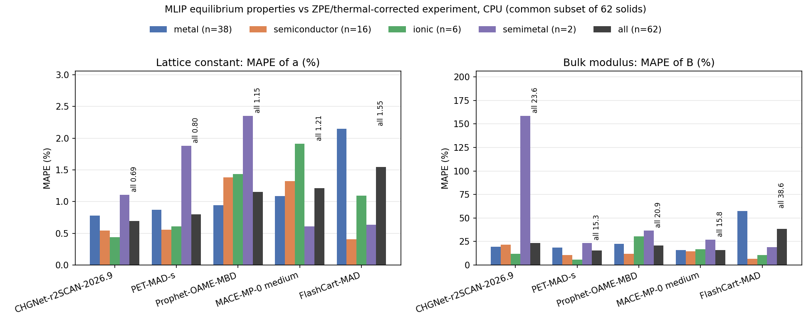
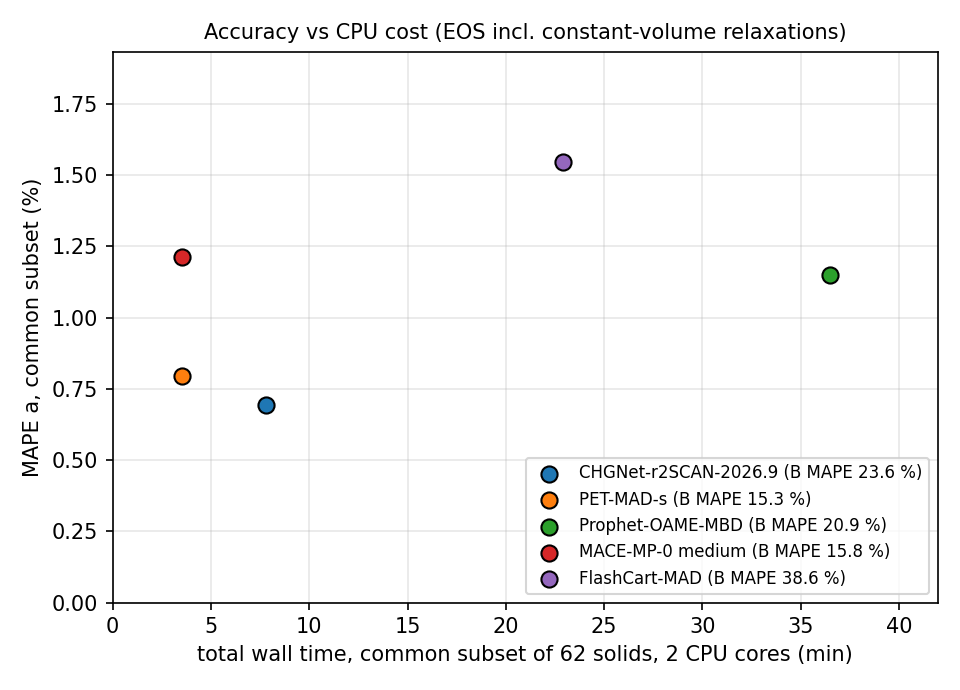
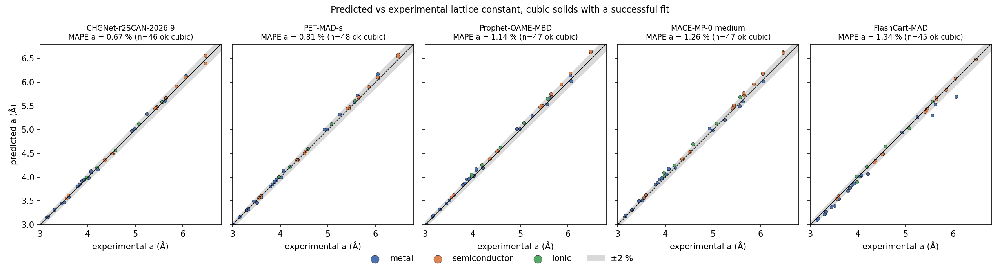

# MLIP CPU benchmark 2026: equation of state vs corrected experiment

Updates: [@woongworks on X](https://x.com/woongworks)

Five machine-learned interatomic potentials, run on 2 CPU cores, fitted to a third-order Birch–Murnaghan
equation of state on 70 solids. The equilibrium volume, expressed as a volume-equivalent lattice constant *a*,
and the bulk modulus *B* are compared with experimental values corrected to the static-lattice limit
(thermal expansion and zero-point effects removed; TSB16 and LEJ14).

> Before using model weights or model-generated outputs commercially, check the checkpoint-specific licences
> ([THIRD_PARTY_LICENSES.md](THIRD_PARTY_LICENSES.md)). The licence of the CHGNet-r2SCAN-2026.9 weights is unknown.

## Headline

Common set: the 62 solids that every model fitted successfully. MAPE = mean absolute percentage error,
ME = mean signed error (positive = the model overestimates). *a* here is the volume-equivalent linear size,
100 × [(V0 / V_ref)^(1/3) − 1] per atom, for every solid including the non-cubic ones (see *Method*).

| Model | ok / 70 | MAPE a (%) | MAPE B (%) | ME a (%) | ME B (%) | wall, common set (s) |
|---|---|---|---|---|---|---|
| CHGNet-r2SCAN-2026.9 | 66 | 0.69 | 23.6 | +0.24 | +11.7 | 469 |
| PET-MAD-s | 68 | 0.80 | 15.3 | +0.49 | −12.3 | 211 |
| Prophet-OAME-MBD | 69 | 1.15 | 20.9 | +1.05 | −10.2 | 2189 |
| MACE-MP-0 medium | 69 | 1.21 | 15.8 | +1.04 | −6.6 | 211 |
| FlashCart-MAD | 67 | 1.55 | 38.6 | −1.33 | +32.1 | 1375 |

- Lowest observed MAPE a: CHGNet-r2SCAN (0.69 %). Lowest observed MAPE B: PET-MAD-s (15.3 %), with MACE-MP-0 at
  15.8 %. A 0.5-point gap on 62 solids does not establish a stable winner on B.
- On the 62 common successful cases, the reported MAPE a ranges from 0.69 % to 1.55 %.
- These are observed workflow runtimes; shared-host contention and different model-loading policies prevent a
  controlled speed comparison. PET-MAD-s and MACE-MP-0 had the shortest observed times (211 s each).
- We report completion counts over all 70 solids. Accuracy averages use only the 62 solids completed by every model;
  failures receive no numerical penalty in those averages. Failures:
  CHGNet: B, Cs, Ga, Po · PET-MAD-s: As, Zn · Prophet: Po · MACE: Po · FlashCart: Ba, Cs, Fe.
  The Po failures (CHGNet, Prophet, MACE) mean the model has no parameters for polonium. They are coverage gaps, not fit failures.
- Prophet did not finish as one job: the sequential run was killed by the 3000 MB memory watchdog on B, so the
  rest ran one solid per process. The B retry used a 3500 MB limit and peaked at 3381 MB.







Per-solid errors: [heatmap of a errors](charts/heatmap_a_err.png), [heatmap of B errors](charts/heatmap_B_err.png).
Full report with per-solid tables, timings and every failure: [BENCHMARK_EN.md](BENCHMARK_EN.md)
(Korean: [BENCHMARK_KO.md](BENCHMARK_KO.md)).

## Method (short)

- **Solids:** 44 cubic solids from TSB16 built with `ase.build.bulk`, plus 26 elements from LEJ14 built from the
  paper's ancillary CIFs scaled to the experimental volume.
- **What *a* means:** the EOS gives an equilibrium volume V0 only. "MAPE a" uses the volume-equivalent linear size,
  100 × [(V0 / V_ref)^(1/3) − 1] with volumes per atom, for all 70 solids. For non-cubic cells this can hide errors in
  axis ratios and angles, which we did not score. The parity chart instead uses the conventional cubic *a*
  for the cubic solids only.
- **E(V):** 11 volumes over 0.94 to 1.06 × V (±6 % in volume), starting at the reference volume.
- **Relaxation:** cells with free shape or internal coordinates (23 of 70) get a constant-volume, symmetry-preserving
  relaxation at each volume: ASE BFGS on `FrechetCellFilter(constant_volume=True)` with `FixSymmetry(symprec=1e-3)`,
  converged when the maximum force/stress component is below fmax = 0.005 eV/Å, at most 300 steps.
  A relaxation that hits 300 steps is kept, and the solid gets a warning in its JSON; it is not counted as a failure.
  In the final E(V) pass this happened only for CHGNet-r2SCAN: 16 of the 242 final-pass volume points of its 22 relaxed solids with E(V) data (Ga failed before any pass completed), i.e. 10 points
  on Hf, Lu, Tc, Y and Zr (fits kept) and 6 on B (which failed the fit checks anyway). The other four models
  converged at every relaxed point.
- **Fit:** third-order Birch–Murnaghan (`ase.eos`). If |V0 / V_centre − 1| > 3 %, the grid is recentred and refitted,
  at most 3 passes. A fit fails if V0 is outside the sampled range, B0 ≤ 0 or an energy is not finite.
  Solids that needed recentring (more than one pass), out of 70: CHGNet 20, PET-MAD-s 19, Prophet 33, MACE 32,
  FlashCart 39.
- **Fit residuals** (RMS of E − E_BM over the 11 points of the final pass, meV/atom, 62 common solids):

  | Model | median | max |
  |---|---|---|
  | CHGNet-r2SCAN | 0.14 | 2.89 (Sb) |
  | PET-MAD-s | 0.008 | 0.27 (Re) |
  | Prophet | 0.074 | 19.75 (Co) |
  | MACE-MP-0 | 0.006 | 0.04 (Co) |
  | FlashCart | 0.010 | 0.88 (Rb) |

  Prophet's Co residual is large and its Co result should be read with that in mind. Per-solid residuals are in
  `results/<model>/<solid>.json` (`fit_rms_meV_per_atom`).
- **No spin, no k-points, float64 where supported.** One model at a time, `taskset` to 2 cores, `nice -n 10`, 2 threads,
  3000 MB RSS watchdog.

## Limitations

- **Scope:** this is a local EOS check around the experimental structure and reference volume. It says nothing
  about how the models find new structures, about other chemistries, or about performance in large screening runs.
- **Magnetism:** we did not specify or optimise magnetic order, so this benchmark does not test recovery of the
  correct magnetic states of Fe, Co, Ni or Cr.
- **Non-cubic cells:** MAPE a is volume-based and does not score axis ratios or angles.
- **Oxides:** MgO is the only oxide, so there is no oxide average.
- **Bulk modulus:** experimental B has several % uncertainty, and soft metals (K, Rb, Cs, Ba) with very small B
  produce large percentage errors that dominate MAPE B.
- **References are not independent:** TSB16 reuses the LEJ14 corrections for elements. Zero-point corrections are model-based.
- **Coverage:** the common set leans towards cubic solids.
- **Timing:** observed on a shared machine with 2 threads. Model loading differs: Prophet's totals include one model
  load per solid after its watchdog restart.
- **Static lattice only:** no phonons or finite temperature.

## Repository layout

```
bench_mlip.py              protocol: build, E(V), relax, EOS fit, one JSON per solid
job.sh                     taskset + nice + RSS watchdog wrapper, writes logs/<job>.res
run_all.sh                 all five models, sequentially
run_prophet_remaining.sh   the one-solid-per-process Prophet driver used after the watchdog kill
aggregate.py               results -> results/tables.md, summary.json, all_results.csv, charts/
make_reports.py            BENCHMARK_EN.md / BENCHMARK_KO.md
build_refs.py              raw references -> refs/solids.json
fetch_refs.sh              downloads the raw references and checks sha256
results/<model>/*.json     per-solid results (one file per solid, plus _run.json)
logs/*.res, *.run.json     job records (wall time, peak RSS, exit code)
refs/solids.json           the 70 reference solids with source and correction fields
```

## Reproduce

Re-draw tables, charts and the report from the shipped results (needs numpy, pandas, matplotlib):

```bash
python3 aggregate.py && python3 make_reports.py
```

Rebuild the reference table (needs ase and poppler-utils; the output should be byte-identical to `refs/solids.json`):

```bash
./fetch_refs.sh && python3 build_refs.py
```

Full re-run: one Python 3.12 virtualenv per model under `venvs/` (or set `MLIP_VENVS`). Versions used
(complete package lists of the venvs used for the published run: [env/](env/)):

| venv | packages |
|---|---|
| `matgl` | matgl 4.1.3, torch 2.15.0+cpu, ase 3.29.0 |
| `mace` | mace-torch 0.3.17, torch 2.15.0+cpu, ase 3.29.0 |
| `upet` | upet 0.3.1, torch 2.14.1+cpu, ase 3.29.0 |
| `prophet` | prophet-mlip 1.0.1, torch 2.15.0+cpu, ase 3.29.0 |
| `flashcart` | flashcart 0.1.0, torch 2.15.0+cpu, ase 3.29.0 |

Checkpoints actually loaded (SHA-256 of the files on disk):

| Model | How it is selected in `bench_mlip.py` | File | SHA-256 |
|---|---|---|---|
| CHGNet-r2SCAN | `matgl.load_model("CHGNet-PES-MatPES-r2SCAN-1M-2026.9")`, HF `materialyze/CHGNet-PES-MatPES-r2SCAN-1M-2026.9` @ `ec1d760b` | `model.pt` / `state.pt` | `188206ed…` / `c057cdeb…` |
| PET-MAD-s | `UPETCalculator(model="pet-mad-s", version="latest")`, resolved to v1.6.0 from HF `lab-cosmo/upet` @ `06774bd7` | `pet-mad-s-v1.6.0.ckpt` | `3f52e97c…` |
| MACE-MP-0 medium | `mace_mp(model="medium", default_dtype="float64")`, chosen explicitly; in mace-torch 0.3.17 the default (`model=None`) is `medium-mpa-0`, which we did not use | `2023-12-03-mace-128-L1_epoch-199.model` (cached as `20231203mace128L1_epoch199model`) | `01bfe221…` |
| Prophet-OAME-MBD | `KairosCalculator(model_path="prophet-oame-mbd.pt")` | `prophet-oame-mbd.pt` | `28b21122…` |
| FlashCart-MAD | MAD checkpoint, seed 0, cutoff 5 Å (Zenodo 10.5281/zenodo.23159584) | `…_r5.0_s0/best/model.pt` | `cb37c739…` |

Full hashes are in [THIRD_PARTY_LICENSES.md](THIRD_PARTY_LICENSES.md). CHGNet-r2SCAN ran with matgl 4.1.3 and checkpoint revision
`ec1d760b`. We did not check whether fixes listed in the matgl changelog (three-body force/stress autograd,
periodic line graphs) change results for this checkpoint at this version.

Prophet and FlashCart load checkpoints from `MLIP_MODEL_DIR` (default `./models`): put `prophet-oame-mbd.pt`
there, and extract the FlashCart MAD archive (Zenodo 10.5281/zenodo.23159584) so that
`flashcart/models/mad/i3c3f96l2_lr2.5e-3_wd1.2e-2_fw0.1_r5.0_s0/best` exists under it. Then:

```bash
./fetch_refs.sh
CORES=0,1 ./run_all.sh            # pick two cores on your machine
python3 aggregate.py && python3 make_reports.py
```

## Licence

Code, results and charts: MIT ([LICENSE](LICENSE)). Models keep their own licences (see
[THIRD_PARTY_LICENSES.md](THIRD_PARTY_LICENSES.md)). Before using model weights or model-generated outputs
commercially, check the checkpoint-specific licences. The licence of the CHGNet-r2SCAN-2026.9 weights is unknown.
Reference data: cite TSB16 and LEJ14 ([refs/README.md](refs/README.md)).
